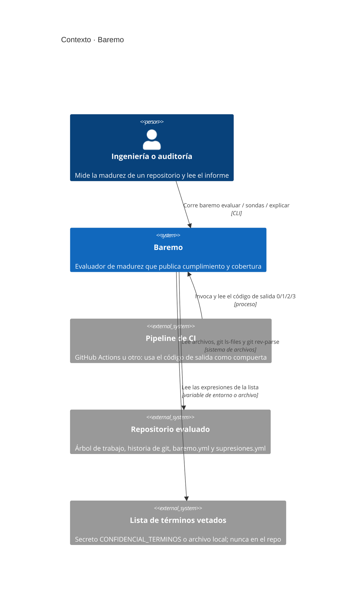
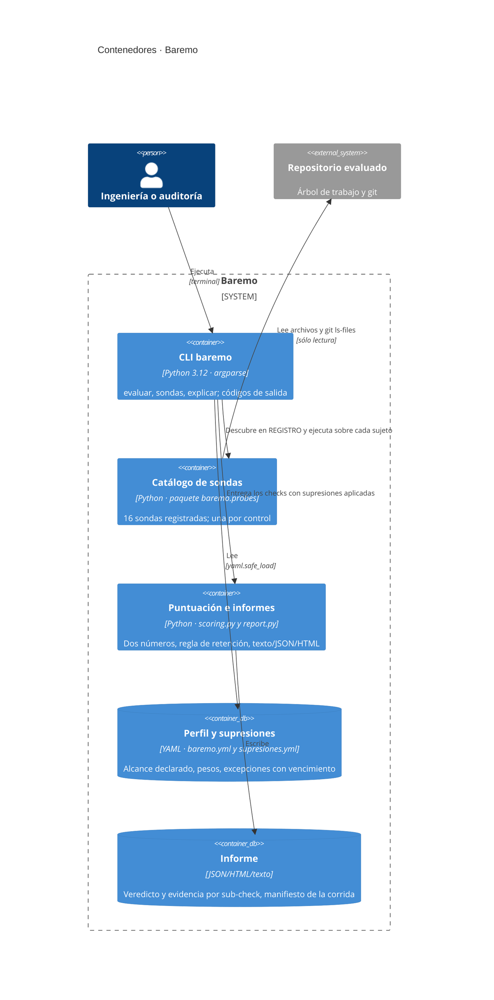
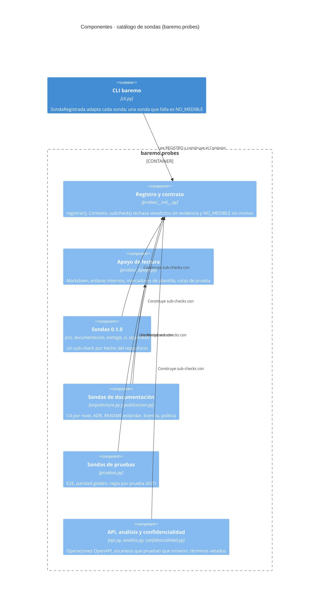

# Arquitectura · Baremo

Modelo C4: contexto → contenedores → componentes. Los diagramas son texto (Mermaid), se versionan
con el código y Baremo los verifica sobre sí mismo con la sonda `documentacion.arquitectura-c4`.
Las decisiones que explican esta forma están en [../adr/](../adr/).

## 1. Contexto

Baremo es una herramienta de línea de comandos sin servicio ni red: la corre una persona o un
pipeline sobre un repositorio y devuelve un informe y un código de salida.

## 2. Contenedores

Un solo proceso de Python 3.12 con una dependencia (PyYAML). Los «contenedores» son las piezas
desplegables por separado: la CLI, el catálogo de sondas (paquete importable, extensible por
terceros) y los archivos que entran y salen.

## 3. Componentes del catálogo de sondas

## Notas

- `baremo/config.py`, `baremo/manifiesto.py` y `baremo/supresiones.py` existen como API de
  biblioteca, pero la CLI no los usa: `cli.py` tiene su propia carga de configuración, manifiesto
  y aplicación de supresiones. Las pruebas de reglas de la CLI (`tests/test_cli_reglas.py`)
  ejercen el camino que usa el producto.
- Todo sub-check por elemento se nombra `<sujeto>/<tipo>:<nombre>` (`sujeto_de`), para que en
  una corrida con varios repositorios una supresión no tape el elemento homónimo de otro.
